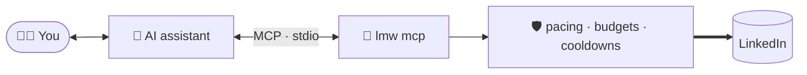

<p align="center">
  
</p>

<p align="center">
  <a href="https://github.com/MarcZX10/LinkedinMechaWarrior/releases/latest"></a>
  <a href="https://github.com/MarcZX10/LinkedinMechaWarrior/actions/workflows/release-on-push.yml"></a>
  
  <a href="https://marczx10.github.io/LinkedinMechaWarrior/"></a>
  <a href="docs/guides/ai-assistants.md"></a>
  <a href="LICENSE"></a>
</p>

<h3 align="center">
  Your LinkedIn, piloted from the terminal.<br>
  One static binary · no browser · never logs in · paced like a human · armored like a mech.<br>
  Now with an AI co-pilot.
</h3>

<p align="center">
  <a href="#-launch-sequence">Launch</a> ·
  <a href="#-loadout">Loadout</a> ·
  <a href="#-ai-co-pilot">AI co-pilot</a> ·
  <a href="#%EF%B8%8F-armor-plating">Armor</a> ·
  <a href="#-field-repairs">Field repairs</a> ·
  <a href="https://marczx10.github.io/LinkedinMechaWarrior/">Pilot's manual</a>
</p>

```text
┌─ LMW-01 · LINKEDIN MECHAWARRIOR ─────────────────────────────────────── BOOT ─┐
│  session ............ your browser's, sealed in the system keyring    [ OK ]  │
│  tls fingerprint .... same JA4 and HTTP/2 as a real Chromium          [ OK ]  │
│  pacing ............. 2-6 s between requests · 60/h · 300/day        [ OK ]  │
│  weapons ............ safety on: every write asks you first          [ OK ]  │
│  ai co-pilot ........ MCP on stdio, read-only until you say so       [ READY ]│
│  bulk mode .......... not installed, on purpose                       [ -- ]  │
└───────────────────────────────────────────────────────────────────────────────┘
```

> [!WARNING]
> **Rules of engagement.** `lmw` drives LinkedIn's *internal* web API, which
> goes against LinkedIn's User Agreement and can get your account restricted.
> It is built to keep usage light and human-paced, but the risk is never zero.
> Pilot your own account only, at your own risk. Read
> [Stay safe](docs/guides/stay-safe.md) before your first sortie.

## 🛰️ Mission briefing

**`lmw`** is a command-line client for your own LinkedIn account. It reads your
feed, profiles, messages, notifications and invitations; it posts, comments,
reacts, messages and connects (always after you confirm); it searches people,
companies and jobs; and it lets an AI assistant do all of that for you over
the [Model Context Protocol](docs/guides/ai-assistants.md).

There is no browser in the cockpit. `lmw` speaks plain HTTP that looks exactly
like your browser's, reuses the session you already have, and stops at the
first sign of pushback from LinkedIn.

## ⚡ Launch sequence

**1. Get the unit.** Download `lmw-linux` or `lmw.exe` from
[Releases](https://github.com/MarcZX10/LinkedinMechaWarrior/releases/latest),
or build it with Go:

```bash
go install github.com/MarcZX10/LinkedinMechaWarrior/cmd/lmw@latest
```

**2. Board.** Log in to LinkedIn in your browser as usual, save a HAR file from
the developer tools ([how](docs/guides/import-session.md)), and hand it over:

```bash
lmw auth import --har linkedin.har
```

```text
Browser identity copied from the HAR file: Mozilla/5.0 (Windows NT 10.0; Win64; x64) ... Chrome/152.0.0.0 Safari/537.36
Learned 6 GraphQL query versions from the HAR file.
Logged in as Ada Lovelace.
Session from HAR file saved in the system keyring.
```

**3. Fly.**

```bash
lmw doctor --online                       # preflight checks
lmw me                                    # who's in the cockpit
lmw feed -n 20                            # what's on the radar
lmw messages                              # incoming transmissions
lmw notifications                         # alerts
lmw post publish --text-file post.txt     # fire, after you confirm
```

Ten minutes from zero to your feed in the terminal:
[Getting started](docs/getting-started.md).

## 🦾 Loadout

| Bay | Commands | What it does |
|---|---|---|
| 📡 **Intel** | `me` · `feed` · `profile show` · `profile posts` · `profile contact` · `notifications` · `saved` | Your profile and feed, anyone's profile and posts, contact info, alerts, saved posts |
| 💬 **Comms** | `messages` · `messages show` · `messages send` · `messages read` | Inbox and folders, conversations, replies and new chats |
| 🤝 **Diplomacy** | `invitations` · `invitations accept/ignore/sent/withdraw` · `connect` · `connections` · `connections remove` | Connection requests both ways, your network |
| 🎯 **Engagement** | `post draft/preview/publish` · `post edit` · `post show` · `post comments` · `post reactions` · `post react/unreact` · `post comment` · `post reply` · `post delete` | Publish with images, video, PDFs, polls or link cards, now or scheduled; react to and answer posts and comments |
| 🔭 **Recon** | `search people/companies/schools/groups` · `company show` · `jobs search` · `jobs show` · `jobs tracked` | Find people and pages, read job postings, follow your applications |
| 🛰️ **Signals** | `profile follow/unfollow` · `company follow/unfollow` | Tune what reaches your feed |
| 🤖 **Co-pilot** | `mcp` · `mcp --allow-write` | Hand the controls to an AI assistant, under your watch |
| 🔧 **Workshop** | `doctor` · `api get` · `har inspect` · `har learn` · `identity` · `limits` · `auth` | Preflight checks, explore the API, learn LinkedIn's latest changes, check budgets |

Every command that shows data speaks `--json`, so the output flows into `jq`,
scripts and dashboards. Profiles, posts, companies and jobs can be given as the
address you copy from your browser.

```bash
lmw profile show https://www.linkedin.com/in/ada-lovelace/
lmw search people "rust developer" --network 2nd -n 20
lmw jobs search go developer --location Barcelona --workplace remote,hybrid --posted week
lmw post react https://www.linkedin.com/feed/update/urn:li:activity:7123456789012345678/ --type celebrate
lmw post publish --text-file launch.txt --image mech.png --alt "LMW-01 on the launch pad" --at "2026-11-05 09:30"
lmw messages send --to ada-lovelace --text "Ready for launch?"
lmw invitations --json | jq -r '.[] | "\(.id) \(.name)"'
```

## 🤖 AI co-pilot

`lmw mcp` turns the unit into an [MCP](https://modelcontextprotocol.io/) server,
so assistants like Claude Code can read your LinkedIn and, if you allow it, act
on it. One line to dock it:

```bash
claude mcp add linkedin -- lmw mcp                 # read-only co-pilot
claude mcp add linkedin -- lmw mcp --allow-write   # co-pilot with weapons
```

Or in any MCP client's config (Claude Desktop's `claude_desktop_config.json`):

```json
{ "mcpServers": { "linkedin": { "command": "lmw", "args": ["mcp"] } } }
```



- **35 tools**: feed, profiles, posts with images and polls, comments and
  replies, reactions, messages, notifications, invitations, connections,
  search, companies, jobs and your job tracker, saved posts, budgets.
- **Read-only by default.** Tools that change something only exist with
  `--allow-write`, and your client asks you before each call.
- **You see the payload.** Clients with MCP elicitation get the exact text to
  be posted or sent, and `lmw` waits until you accept it.
- **Same armor as you.** The co-pilot goes through the same pacing, budgets and
  cooldowns; it can't fly faster than you would.

Full briefing: [Use lmw from an AI assistant](docs/guides/ai-assistants.md).

## 🛡️ Armor plating

| Plate | What it does |
|---|---|
| **Browser camouflage** | TLS and HTTP/2 fingerprint identical to Chromium (same JA4), with matching User-Agent and client hints. Import a HAR and it copies your own browser's exact headers and their order. [More](docs/guides/browser-identity.md) |
| **No login, ever** | Reuses the session of the browser you already use, 2FA included, and keeps it in the system keyring. [More](docs/guides/import-session.md) |
| **Human pacing** | Random 2-6 s pauses, longer ones now and then, across separate runs. Hourly and daily budgets. [More](docs/guides/stay-safe.md) |
| **Ejection seat** | Rate limit → 1 h cooldown. Security check → 6 h cooldown. Expired session → stop. Never retries on its own. |
| **Trigger safety** | Every post, comment, reaction, message, invitation and follow shows what it will do and waits for you to type a word. Files are uploaded only after that. |
| **No bulk weapons** | No mass messaging, mass inviting or scraping. Volume is what gets accounts restricted. |
| **Radio silence** | No telemetry. The only traffic is to LinkedIn, for the command you run. |

## 🔧 Field repairs

LinkedIn changes its website without notice. Much of it now runs on GraphQL
queries whose version hash changes with each deploy, so `lmw` carries several
known versions of each and switches to the next when one is rejected. When
they all fail, the error tells you, and a field repair takes one command:

```bash
lmw doctor --probe               # which features work with your account today?
lmw har learn linkedin.har       # learn the versions the website uses today
```

`doctor --probe` reads a little of every feature, about a dozen paced
requests, and stops at the first sign of pushback.

For deeper repairs, `lmw har inspect` shows every call the website made and
`lmw api get` reproduces them. [Extend lmw](docs/guides/extend-lmw.md) walks
through turning that into a new command.

> [!NOTE]
> **Flight log, 2 November 2026.** `lmw doctor --probe` against a live account:
> profile, feed, full profiles, notifications, invitations, connections,
> messages, job search and company pages all answered and were read. Search
> (`search`, and `saved` and `jobs tracked`, which use the same query) answered
> 200 but empty for every query, so it needs a fresh capture of what the website
> sends. The writes follow payloads public clients verified live in 2026 and are
> covered by `lmw`'s tests against a simulated LinkedIn. If something fails,
> [Troubleshooting](docs/troubleshooting.md) says what to do.

## 📖 Pilot's manual

The full documentation lives at
**[marczx10.github.io/LinkedinMechaWarrior](https://marczx10.github.io/LinkedinMechaWarrior/)**
([also in the repo](docs/README.md)).

| Start here | Missions | Reference |
|---|---|---|
| [Getting started](docs/getting-started.md) | [Read LinkedIn](docs/guides/read-linkedin.md) | [Every command](docs/reference/lmw.md) |
| [Connect your account](docs/guides/import-session.md) | [People, messages and your network](docs/guides/people-and-messages.md) | [Configuration](docs/configuration.md) |
| [Stay safe](docs/guides/stay-safe.md) | [React, comment and search](docs/guides/posts-and-search.md) | [Troubleshooting](docs/troubleshooting.md) |
| [Glossary](docs/glossary.md) | [Write and publish posts](docs/guides/write-posts.md) | [FAQ](docs/faq.md) |
| | [Use lmw from an AI assistant](docs/guides/ai-assistants.md) | [How it works](docs/how-it-works.md) |

## 🏗️ Hangar

```bash
go test ./...                                        # never contacts LinkedIn
go build -o lmw ./cmd/lmw
go test ./internal/cli -run TestReference -update    # regenerate docs/reference
```

- `internal/api` knows the endpoints and parsers, `internal/voyager` flies the
  requests, `internal/pacing` keeps the pace, `internal/mcp` is the co-pilot
  link, `internal/cli` is the cockpit. Tour: [How it works](docs/how-it-works.md).
- The documentation site is built from `docs/` with Material for MkDocs and
  published by `.github/workflows/docs.yml`. Preview it with
  `pip install -r .github/docs-requirements.txt` and `mkdocs serve`.
- Every pushed commit is built, tested and released for Linux and Windows by
  `.github/workflows/release-on-push.yml`: regular releases from `main`,
  prereleases from other branches.

## License

MIT. `lmw` is an independent project, not affiliated with or endorsed by
LinkedIn. LinkedIn is a trademark of LinkedIn Corporation.
