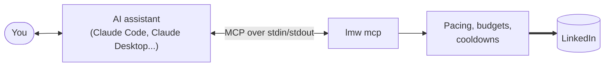

# Use lmw from an AI assistant

> **Short version:** `claude mcp add linkedin -- lmw mcp` lets Claude Code read
> your LinkedIn through `lmw`. Add `--allow-write` to also let it post,
> comment, message and answer invitations, each time with your approval.

`lmw mcp` runs `lmw` as a [Model Context Protocol](https://modelcontextprotocol.io/)
(MCP) server. Your assistant starts it in the background and calls its
*tools*: "get my feed", "search people", "send a message"... Every call goes
through the same session, pacing, budgets and cooldowns as the commands you
type, so the assistant can't make `lmw` go faster or do more than you could.



## Before you start

1. [Install `lmw` and import your session](../getting-started.md).
2. Check that it works:

```bash
lmw auth status
```

## Add it to your assistant

### Claude Code

```bash
claude mcp add linkedin -- lmw mcp
```

That adds it to the current project. To have it everywhere, add
`--scope user` after `add`. Then just ask, for example: *"What happened in
my LinkedIn notifications this week?"*

### Claude Desktop

Open **Settings › Developer › Edit Config** and add `lmw` to
`claude_desktop_config.json`, then restart Claude Desktop:

```json
{
  "mcpServers": {
    "linkedin": { "command": "lmw", "args": ["mcp"] }
  }
}
```

On Windows, give the full path to the program, e.g.
`"command": "C:\\Tools\\lmw.exe"`.

### Other MCP clients

Any client that runs local (stdio) MCP servers works: the command is `lmw`
and the arguments are `mcp`, plus `--allow-write` if you want it.

## Reading and writing

By default the assistant only gets tools that **read**. To let it change
things on LinkedIn, start the server with `--allow-write`:

```bash
lmw mcp --allow-write
```

(with Claude Code: `claude mcp add linkedin -- lmw mcp --allow-write`).

Even then, nothing is posted or sent behind your back:

- Your MCP client asks you to approve each tool call.
- Clients that support MCP *elicitation* also get from `lmw` the exact text
  to be posted or sent, and `lmw` waits until you accept it.
- Posts with unfilled `[placeholders]`, notes longer than LinkedIn allows and
  the like are refused before anything is sent.

## Tools

| Tool | What it does | Changes LinkedIn |
|---|---|:---:|
| `get_my_profile` | Your profile; also checks the session | |
| `get_feed` | Your home feed | |
| `get_profile`, `get_profile_posts`, `get_contact_info` | A member's profile, posts and contact info | |
| `get_post`, `get_post_comments`, `get_post_reactions` | A post, its comments and who reacted | |
| `list_conversations`, `get_conversation` | Your inbox and the messages of a conversation | |
| `get_unread_counts` | Unread notifications, messages and invitations, by the top bar badges | |
| `get_notifications` | Your notifications | |
| `list_invitations`, `list_connections` | Connection requests and your connections | |
| `search` | People, companies, schools or groups | |
| `get_company` | A company or school page | |
| `search_jobs`, `get_job`, `get_tracked_jobs` | Job search, postings and your job tracker | |
| `get_saved_posts` | The posts you saved | |
| `get_request_budget` | Requests used and any cooldown (sends nothing) | |
| `linkedin_api_get` | Raw GET to the internal API, for anything else | |
| `create_watch`, `list_watches`, `delete_watch`, `check_watches` | Keep an eye on something and tell you later: someone's next post, new jobs, messages ([watches](watches.md)) | |
| `list_notification_channels`, `send_notification` | Where notifications go, and a notification of the assistant's | |
| `publish_post` | Publish a post, with images, a video, a PDF, a poll or a link card, now or scheduled | ✔ |
| `edit_post` | Replace the text of one of your posts | ✔ |
| `comment_on_post`, `reply_to_comment` | Comment on a post, reply to a comment | ✔ |
| `react_to_post`, `remove_reaction` | React to a post or a comment, or take it back | ✔ |
| `delete_post` | Delete one of your posts | ✔ |
| `send_message`, `mark_conversation_read` | Send a message, mark a conversation as read | ✔ |
| `answer_invitation`, `withdraw_invitation` | Accept or ignore an invitation, withdraw yours | ✔ |
| `send_connection_request`, `remove_connection` | Connect with a member, or remove a connection | ✔ |
| `set_following` | Follow or unfollow a member or a company | ✔ |

Profiles, posts, companies and jobs can be given as their LinkedIn address,
so you can paste links into the conversation.

Watches and notification channels are `lmw`'s own settings, not LinkedIn,
so their tools are offered without `--allow-write`. Ask "tell me when Grace
Hopper posts next" and the assistant adds a watch; `lmw daemon` does the
watching and notifies you, even with the assistant closed. To run it all on a
server, see [Watches, notifications and servers](watches.md).

## Good to know

- **It is slow on purpose.** Each request waits a few random seconds after
  the previous one, and the hourly and daily budgets are shared with the
  commands you run yourself. Ask for what you need: *"the 5 latest
  messages"*, not *"read all my messages"*.
- **When LinkedIn pushes back, it stops.** If a tool reports a cooldown, a
  security check or an expired session, the assistant can't fix it; follow
  [Troubleshooting](../troubleshooting.md) yourself.
- **The assistant sees what the tools return:** your messages, contacts and
  notifications. Use `lmw mcp` only with assistants and providers you trust
  with that.
- **Debug logs:** `lmw mcp -v` writes every request to stderr, which most
  clients keep in their MCP server logs.
- **No bulk.** Don't ask it to connect with a hundred people or message every
  contact: volume is the main thing that gets accounts restricted. See
  [Stay safe](stay-safe.md).
