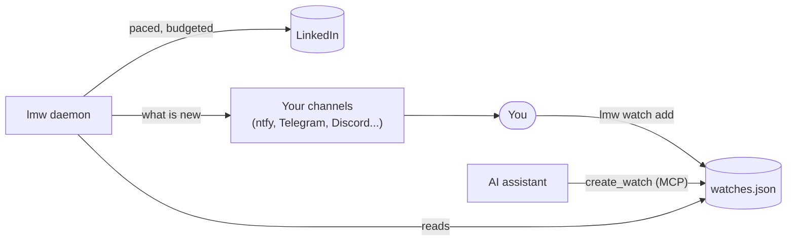

# Watches, notifications and servers

> **Short version:** `lmw notify add phone ntfy:my-secret-topic` tells `lmw`
> where to reach you, `lmw watch add posts linkedin.com/in/grace-hopper --once`
> asks it to tell you about Grace's next post, and `lmw daemon`, left running
> on a computer that stays on, does the watching. Your AI assistant can add
> watches too: "tell me when Grace posts next".

A *watch* is something `lmw` keeps an eye on for you. Each check reads
LinkedIn once or twice, compares what it sees with the previous check, and
sends what is new to your *notification channels*.



## 1. Tell lmw where to reach you

```bash
lmw notify add phone ntfy:my-secret-topic
lmw notify test phone
```

A channel has a name and a target:

| Target | Sends |
|---|---|
| `ntfy:TOPIC` | A push notification to the [ntfy](https://ntfy.sh/) app subscribed to TOPIC. Pick a topic nobody can guess. `ntfy:https://your.server/topic` uses your own ntfy server. |
| `telegram:BOT_TOKEN:CHAT_ID` | A message from your Telegram bot (create one with @BotFather, then send it a message and read your chat id). |
| `discord:WEBHOOK_URL` | A message in a Discord channel, through its webhook. |
| `slack:WEBHOOK_URL` | A message in a Slack channel, through its incoming webhook. |
| `webhook:URL` | A JSON POST to your own URL: `title`, `text`, `url`, `watch`, `time`. |
| `command:COMMAND` | A command in your shell, with `LMW_TITLE`, `LMW_TEXT`, `LMW_URL` and `LMW_WATCH`. |

Targets can hold tokens, so `lmw` keeps them in `notify.json` in its state
folder, readable only by you, and `lmw notify list` shows them masked. URLs
must be `https` (plain `http` only on this computer).

`lmw notify send "text" --to phone` sends a notification of yours, for
scripts.

!!! note "What leaves your computer"
    A notification carries a title, a short piece of what was found (up to
    280 characters of a post, comment or message) and a link, to the service
    you chose. Nothing else: no session, no cookies.

## 2. Add watches

```bash
lmw watch add posts linkedin.com/in/grace-hopper --once
lmw watch add jobs "go developer" --location Spain --workplace remote --every 2h
lmw watch add messages --to phone
lmw watch add comments https://www.linkedin.com/feed/update/urn:li:activity:7123456789012345678/
```

| Kind | Tells you about | Target | Requests per check |
|---|---|---|---|
| `posts` | New posts and reposts by a member | A profile | 1 |
| `profile` | Changes to a member's headline or current job | A profile | 1 |
| `comments` | New comments on a post | A post | 1, or 2 for a repost |
| `jobs` | New job postings for a search (`--location`, `--workplace`, `--posted`) | Keywords | 1 |
| `views` | New people viewing your profile | | 1 |
| `invitations` | New connection requests | | 1 |
| `messages` | New messages in your inbox | | 2 |
| `notifications` | New notifications | | 1 |
| `unread` | More unread notifications, messages or invitations (the top bar badges) | | 1 |

- Adding a watch checks it once right away. That first check only takes
  note of what is there, so you hear about what comes **after** you added it.
- `--every` sets how often it is checked: 30 minutes by default, 15 at least.
- `--once` ends the watch after its first notification: "the next post of".
- `--to` picks a channel; without it, notifications go to every channel.
- `--note` says why, in your words; `lmw watch list` shows it.

```bash
lmw watch list
```

```text
a1b2c3  new posts by a member: grace-hopper, every 30m0s, once
    checked 2026-11-02 18:40
9f8e7d  new job postings for a search: go developer, every 2h0m0s → phone
    checked 2026-11-02 18:41 · 3 found

2.5 requests an hour of 6 allowed for watches.
```

`lmw watch remove a1b2c3` stops a watch.

### How many requests watches use

All watches together may use a third of the hourly request budget, and half
of the daily budget spread over a whole day. With the default budgets (60 an
hour, 300 a day) that is about **6 requests an hour**: for example three
`posts` watches every 30 minutes. `lmw` refuses a watch that would go over,
and says how many requests an hour your watches use. So `lmw` always keeps
most of the budget for what you do by hand.

To watch more, raise `LMW_DAILY_REQUEST_BUDGET` and `LMW_HOURLY_REQUEST_BUDGET`
([configuration](../configuration.md)), knowing that more requests look less
like a person.

## 3. Let the daemon watch

```bash
lmw daemon
```

```text
lmw daemon: 2 watches, 2.5 requests an hour. Ctrl-C stops.
2026-11-02 19:10  New post by Grace Hopper  https://www.linkedin.com/feed/update/urn:li:activity:7123456789012345678/
```

The daemon checks each watch when it is due, sends what it finds and prints a
line for it. It looks for new watches every few minutes, so watches you or
your assistant add later are picked up without restarting it.

- When a watch starts failing (a profile that no longer exists, say), the
  daemon tells you once through your channels, and keeps trying.
- When LinkedIn pushes back (a cooldown, the request budget, a security
  check, an expired session), the daemon stops checking, tells you once, and
  waits an hour before trying again. It never insists.

No computer that stays on? `lmw watch run` checks the watches that are due
once and exits; run it from cron or a scheduled task:

```bash
*/15 * * * * lmw watch run
```

## Run lmw on a server, 24/7

A small Linux server (a VPS, a Raspberry Pi) can run the daemon day and
night.

**1. Install `lmw`** on the server ([Getting started](../getting-started.md)),
for example the `lmw-linux` or `lmw-linux-arm64` binary of the latest release.

**2. Bring your session.** Servers usually have no keyring, so keep the
session in a file only your user can read, and import it from a HAR file you
copy over:

```bash
scp linkedin.har my-server:
ssh my-server
export LMW_SESSION_STORE=file
lmw auth import --har linkedin.har
rm linkedin.har
lmw auth status
```

!!! warning "Your session on someone else's computer"
    The session is the key to your LinkedIn account. Put it only on a server
    you control, with your own user, and remove the HAR file once imported.
    The server reaches LinkedIn from its own address, which is not your
    home's: LinkedIn may ask for a security check, or end the session. If it
    does, the daemon stops and tells you; import a fresh session.

**3. Add channels and watches**, as above, on the server.

**4. Keep the daemon running** with a systemd user service. Save this as
`~/.config/systemd/user/lmw.service`:

```ini
[Unit]
Description=lmw daemon: LinkedIn watches
After=network-online.target

[Service]
Environment=LMW_SESSION_STORE=file
ExecStart=%h/.local/bin/lmw daemon
Restart=on-failure
RestartSec=5min

[Install]
WantedBy=default.target
```

```bash
systemctl --user daemon-reload
systemctl --user enable --now lmw
loginctl enable-linger "$USER"   # keep it running after you log out
journalctl --user -u lmw -f      # what it found and sent
```

### Your assistant, talking to the server

The daemon and the MCP server share the watches when they run on the same
computer. Your assistant can start `lmw mcp` on the server through SSH (with
a key, so no password prompt gets in the way):

```bash
claude mcp add linkedin -- ssh my-server LMW_SESSION_STORE=file lmw mcp
```

Then ask it things like:

- "Tell me on my phone when Grace Hopper posts next."
- "Watch remote Go jobs in Spain and tell me about new ones twice a day."
- "Check my watches now." (`check_watches`, handy without a daemon)
- "Send me a summary of today's notifications." (`send_notification`)

Watches and notification channels are `lmw`'s own settings, not LinkedIn,
so the assistant can manage them without `--allow-write`. They still read
LinkedIn within the same budgets as everything else.
